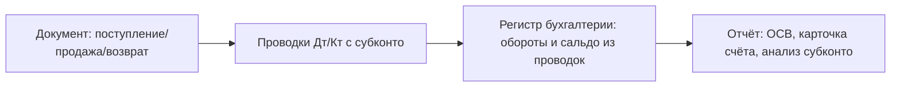

# Учётная модель RIH (task_151)

Учебная модель, а не копия БП: 12 счетов, двойная запись,
сальдо — результат проводок, а не хранимое поле. Модель
исполняема (checks_accounting_model.py): каждая операция ниже
проведена, инвариант и сальдо проверены числами.

## Базовые понятия на нашей модели

- **Счёт** — регистр состояния средств (активный: товары 41,
  деньги 51) или источников (пассивный: капитал 80, налоги 68).
  Активно-пассивные расчёты (60/62) живут с двусторонним сальдо.
- **Проводка** — пара «Дт счёт — Кт счёт — сумма» с аналитикой.
  Двойная запись гарантирует: деньги не появляются из ниоткуда,
  инвариант системы — Σ оборотов Дт = Σ оборотов Кт.
- **Сальдо** — результат всех проводок до даты; исправление
  задним числом поэтому меняет отчёты, и это нормально.
- **Субконто** — аналитика счёта (контрагент, договор, товар):
  счёт без неё отвечает «сколько», с ней — «по кому и по чему».

## Мини-план счетов

| Счёт | Название | Вид | Субконто | Зачем |
|---|---|---|---|---|
| 10 | Материалы | А | номенклатура | сырьё и упаковка |
| 41 | Товары | А | номенклатура, склад | товарные остатки количественно |
| 44 | Расходы на продажу | А | статья расходов | доставка и комиссии |
| 51 | Расчётный счёт | А | банковский счёт | деньги |
| 60 | Расчёты с поставщиками | АП | контрагент, договор | авансы и долги на одном счёте |
| 62 | Расчёты с покупателями | АП | контрагент, договор | дебиторка по именам |
| 68 | Расчёты по налогам | П | вид налога | НДС к вычету/уплате |
| 80 | Уставный капитал | П | — | источник на старте |
| 90.1 | Выручка | П | — | продажи периода |
| 90.2 | Себестоимость | А | — | списанные товары |
| 90.9 | Прибыль/убыток продаж | АП | — | свёртка 90 |
| 99 | Прибыли и убытки | АП | — | результат |

Счёт 60 нельзя сделать «просто пассивным»: аванс поставщику
(мы должны получить товар) и долг перед поставщиком (мы должны
деньги) — разные стороны одного счёта; пассивная модель прячет
авансы в кредите и завышает задолженность.

## 8 типовых операций (проверены инвариантом)

| Операция | Проводки |
|---|---|
| Поступление товара 100 000 + НДС 20 000 | Дт 41 Кт 60 — 100 000; Дт 68 Кт 60 — 20 000 |
| Оплата поставщику | Дт 60 Кт 51 — 120 000 |
| Продажа 150 000, себестоимость 60 000 | Дт 62 Кт 90.1; Дт 90.2 Кт 41 |
| Возврат от покупателя 30 000 / товар 12 000 | Дт 90.1 Кт 62; Дт 41 Кт 90.2 |
| Услуги доставки ТК 8 000 | Дт 44 Кт 60 |
| Финансовый результат 64 000 | Дт 90.9 Кт 99 |
| Аванс поставщику 20 000 | Дт 60 Кт 51 |
| Списание/перемещение внутри | Дт 41 Кт 41 по субконто складов (аналитика меняет, счёт нет) |

Контроль модели числами: обороты периода 584 000 с обеих сторон;
товары 52 000; по счёту 60 Альфа закрыт в 0, Бета — аванс 20 000,
ТК — долг 8 000 (одно общее сальдо спрятало бы все три факта).

## Схема «документ → проводка → отчёт»

Аналитику: документ отвечает «что произошло», проводка — «как
это легло на счета», отчёт строится только из проводок и потому
не может разойтись с документами молча: расхождение видно
в ОСВ раньше, чем в витринах.
