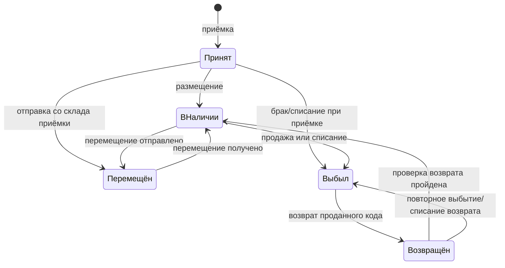

# Модель учёта кодов маркировки (task_116)

## Зачем нужен второй разрез учёта

Количество отвечает на вопрос «сколько товара на складе», но не отвечает
«какие именно единицы». Для маркированных товаров каждая единица и каждый
агрегат имеют уникальный код. Поэтому RIH ведёт два связанных разреза:

- количественный учёт — регистр накопления «ТоварыНаСкладах»;
- поэкземплярный учёт — регистр сведений «КодыМаркировки».

Главный инвариант: для каждой пары «номенклатура + склад» количество
единичных кодов, физически находящихся на складе, равно количественному
остатку. Расхождение не исправляется молча: оно является инцидентом и
попадает в отчёт контроля кодов.

## Регистр «КодыМаркировки»

Измерение:

- `Код` — уникальный код единицы или агрегата.

Реквизиты записи состояния:

- `Номенклатура` — товар, которому принадлежит код;
- `Статус` — текущее состояние конечного автомата;
- `ДокументИсточник` — канонический идентификатор документа, вызвавшего
  переход (`ТипОбъекта:GUID`);
- `ТекущийСклад` — склад фактического нахождения;
- `РодительскийКод` — агрегат, содержащий единицу (пусто для самостоятельной
  единицы и для самого агрегата);
- `ТипКода` — `Единица` или `Агрегат`;
- `ПричинаВыбытия` — продажа, списание или иная причина для статуса «Выбыл».

Регистр периодический (период — момент перехода), поэтому одна таблица
даёт и текущее состояние срезом последних записей, и биографию кода для
отчёта «Движение кодов». Агрегатный родитель не участвует в подсчёте
количества единиц: иначе короб с десятью единицами дал бы одиннадцать.

## Конечный автомат кода

Запрещено всё, что не перечислено: продать выбывший код повторно, получить
неотправленное перемещение, вернуть списанный код, принять уже известный
код на другую номенклатуру. Все проверки сосредоточены в единственной
функции изменения статуса модуля `РИХ_Маркировка`; документы не изобретают
собственные проверки переходов.

## Агрегаты

Приёмка агрегата создаёт родительский код и коды единиц с заполненным
`РодительскийКод`. Перемещение, получение, выбытие и возврат родителя
раскрываются в детей и меняют состояние всей упаковки одним действием.
Нельзя выбыть родителя, оставив детей «в наличии»: такая операция не имеет
отдельного пути в модели — обработчик агрегата всегда работает с полным
составом.

## Контроль и объёмы

Отчёт «Движение кодов» строится по истории регистра за период. Контрольный
отчёт сравнивает количественные остатки и единичные коды в состояниях
«Принят»/«В наличии» по номенклатуре и складу; коды в пути и возвращённые
до размещения в остаток не входят.

Код на каждую единицу означает миллионы записей при больших оборотах.
Поэтому ключ регистра — код, история индексируется парой «код + период»,
а завершённые жизненные циклы подлежат архивации по регламенту task_215;
строковые списки кодов внутри документов моделью запрещены.
