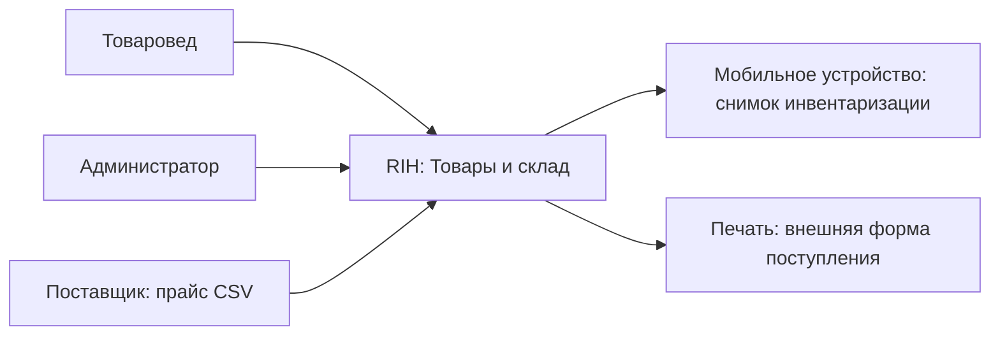
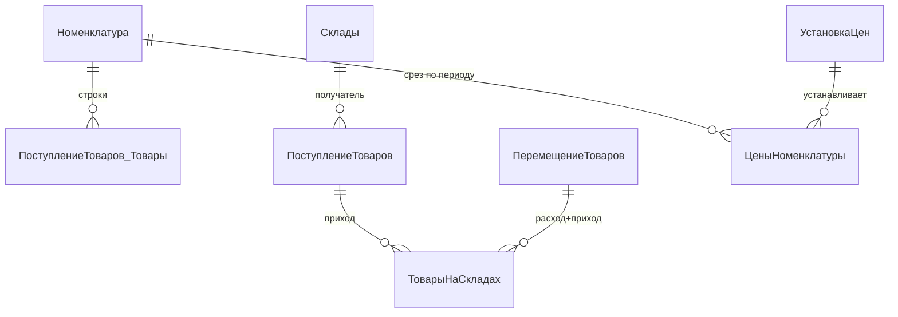
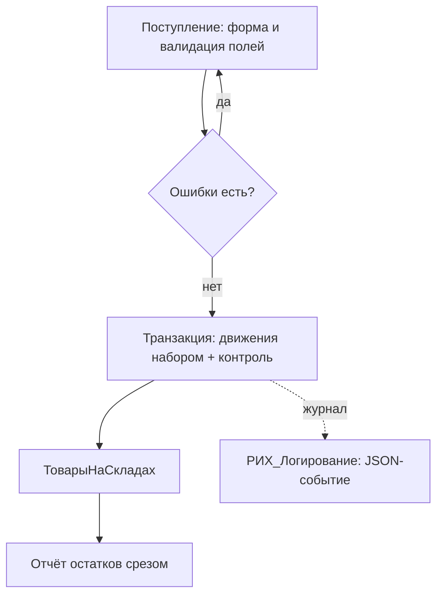

# Защита архитектуры Q1 (task_69)

## Схема 1. Контекст системы (C4, уровень 1)

Читается за минуту: система одна, входов три (люди, файл прайса,
мобильный снимок), выходов два (печать, снимок обратно).

## Схема 2. Модель данных (ядро)

## Схема 3. Поток: поступление → остатки → отчёт

## Отвергнутые альтернативы (честно, с причиной отказа)

| Альтернатива | Почему отвергнута |
|---|---|
| Цена реквизитом номенклатуры | Нет истории и цены на дату (ADR-0002) |
| Перемещение корректировкой поступления | Теряется пара складов и аудит (task_19) |
| Остатки перебором документов | Год документов против среза регистра (task_22) |
| Одна транзакция на загрузку миллиона | Час блокировок, откат всего (task_55) |
| Кэш остатков ради отчётов | Транзакционная свежесть важнее 130 мс (ADR-0006) |
| Правка конфигурации вместо расширения | Обновление типовой сотрёт правило (ADR-0004) |

## Карта рисков

| # | Риск | Вероятность | Влияние | Митигация |
|---|---|---|---|---|
| 1 | Рост движений до 10 млн: отчёт остатков деградирует | Средняя | Высокое | Срезы+индекс готовы; замерить на 10 млн при стенде |
| 2 | Отрицательные остатки при расходе в живой ИБ | Высокая | Высокое | Backlog P1-2, контроль уже в проведении перемещений зеркально |
| 3 | Параллельные проведения: рост ожиданий блокировок | Средняя | Среднее | Порядок блокировок по ключу пары (task_45), ТЖ-порог 1 с |
| 4 | Внешний прайс меняет формат молча | Средняя | Среднее | Валидация содержимого, ЖурналОбменов, 3 попытки (task_47) |
| 5 | Число складов ×10: шарды пересчёта упираются в ядра | Низкая | Среднее | Предел потоков измерен (task_59), лимит по ядрам |
| 6 | Обновление типовой сотрёт доработки | Средняя | Высокое | Расширения (ADR-0004), план task_65, практика task_287 |
| 7 | Кэш порогов устарел после ручной правки | Низкая | Низкое | Сброс писателем, ADR-0006, урок task_62 (точка вызова) |

## Замечания «защиты» (самозащита по вопросам комиссии из регламента)

Вопросы «10 млн строк», «упал внешний API», «как обновим прод»,
«почему не БСП», «как протестировано» отвечены в демо-сценарии
task_68 и ADR; новые задачи из замечаний добавлены в backlog_q2.md
(пункты про 10 млн и лимит параллельных отчётов).
