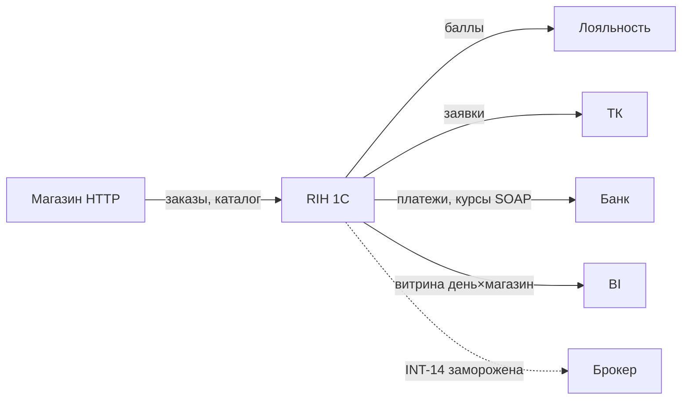
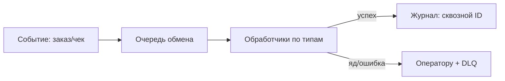
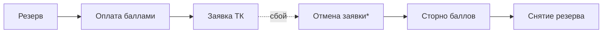
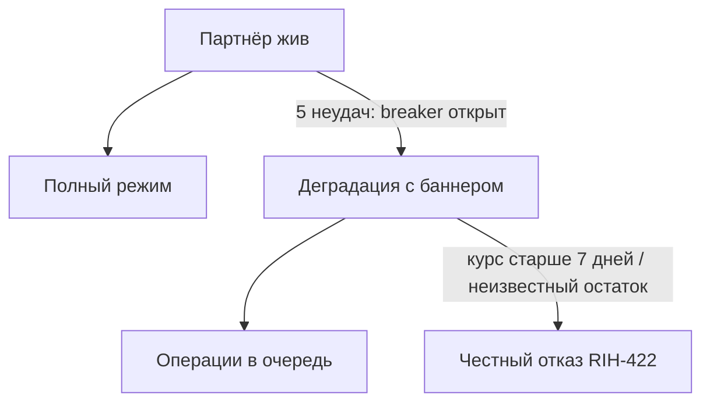

# Пакет защиты интеграционной архитектуры Q2 (task_147)

Каждая схема читается за минуту; цифры — из живых артефактов
квартала с источниками, а не из памяти докладчика.

## Схема 1. Карта интеграций (реестр INT-01…16, task_73/120)

## Схема 2. Потоки событий (task_111)

## Схема 3. Сага с компенсациями (task_130)

\* cancel у ТК в контракте нет — долг контракта, компенсация
журнальная до появления метода (architecture/saga.md).

## Схема 4. Модель деградации (task_131)

## ADR квартала (7, минимум выполнен)

| ADR | Решение | Отвергнутая альтернатива |
|---|---|---|
| 0002 | Цены — регистр версий | поле справочника (нет истории) |
| 0003 | Деньги — распределение по регистрам | ручные проводки |
| 0004 | Расширения вместо правок типовой | доработка конфигурации |
| 0005 | Пакеты по 1000 | построчно / всё разом |
| 0006 | Пороги кэша сеансов | кэш без порогов |
| 0007 | Синхронно/асинхронно по 6 критериям | «как привыкли» |
| 0008 | Витрина вместо живых запросов BI в OLTP | отчёты по транзакционной базе |

## Цифры надёжности (источник у каждой)

| Цифра | Значение | Источник |
|---|---|---|
| Плато приёма заказов стенда | ~1400 запр/с, ошибки 0% | task_143 |
| p95 приёма при параллели 40 | 34 мс (рост от 1 мс — хвост виден раньше ошибок) | task_143 |
| Восстановление после сбоя партнёра | очередь 7/7 доехала без дублей | task_146, task_132 |
| Потери данных в учениях | 0 на 5 инъекциях | task_132 |
| Идемпотентность денег и баллов | двойной платёж/начисление тестами исключены | task_127, task_141 |
| Точка отказа боевого контура | проведение ИБ ×4.5 под аналитикой; лимит ТК 10/мин | task_121, реестр |

## Каверзные вопросы — ответы артефактами

- **Рост ×10.** Упрутся проведение (task_121) и лимиты партнёров;
  HTTP-плато стенда — с запасом ×400 к цели пика (task_143).
- **Партнёр сменил контракт молча.** Canary узнает раньше обмена;
  релиз без контрактов не выйдет (task_140).
- **Проблема раньше бизнеса.** Алерты по хвосту p95 (LOAD-4)
  и состоянию breaker; учения task_132 дали времена обнаружения.
- **Где секреты.** Не в коде: контуры, хеши, сканер в CI (task_134).
- **SLA магазина откуда?** Требования пика → нагрузка task_143 →
  регламент task_108 → метрики task_114: цепочка по документам.

## Названные ограничения (зрелость, а не слабость)

Платформа 1С/EDT и Docker на стенде отсутствуют: живые ИБ-шаги —
точки возврата развёртывания. Брокер INT-14 заморожен без даты.
SOAP банка без подписи сообщений — пересмотр к боевому подключению.

## Замечания «комиссии» → backlog

Само-комиссия по пакету задала 4 замечания (DEF-1..4 в backlog_q2):
подпись SOAP, расписание ночного контура (дублирует PYR-3 —
приоритет поднят), эталоны лояльности/ТК (PYR-1), владелец SLA
пика у бизнеса. Все — задачами с приоритетами в день защиты.
