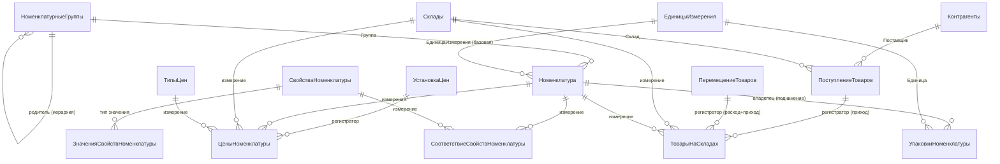

# Модель данных подсистемы «Товары и склад» (task_19)

Требование аналитика: учёт товаров по складам — остатки, поступления,
перемещения, цены разные по складам, характеристики (цвет/размер).
Проектируем до первого объекта: цена реквизитом «потом переделаем»
в прошлом проекте стоила двух спринтов.

## ER-схема (объекты, связи, измерения)

## Объекты (13, минимум по DoD — 8)

| Объект | Тип | Ключевые реквизиты / измерения |
|---|---|---|
| Номенклатура | Справочник | Артикул(стр. 25, индекс), Группа→НоменклатурныеГруппы, ЕдиницаИзмерения→ЕдиницыИзмерения, Вес, Объём, ЭтоУслуга, СтавкаНДС |
| НоменклатурныеГруппы | Справочник иерархический | Родитель→сам себя; элемент номенклатуры группой быть не может |
| ЕдиницыИзмерения | Справочник | Код ОКЕИ |
| УпаковкиНоменклатуры | Справочник, подчинён Номенклатуре | Единица→ЕдиницыИзмерения, Коэффициент (число 15,3) |
| Контрагенты | Справочник | ИНН (стр. 12, индекс) |
| Склады | Справочник иерархический (task_9/13) | ТипСклада→ТипыСкладов (task_24), Адрес, РежимРаботы |
| ПоступлениеТоваров | Документ | Склад, Поставщик→Контрагенты, Организация(строка — долг до task_152); ТЧ Товары: Номенклатура, Упаковка, Количество, КоличествоБазовое, Цена, Сумма |
| ПеремещениеТоваров | Документ | СкладОтправитель, СкладПолучатель; ТЧ как у поступления |
| ТоварыНаСкладах | Регистр накопления «Остатки» | Измерения: Склад, Номенклатура; ресурс Количество. Регистраторы: оба документа |
| ЦеныНоменклатуры | РС периодический (день), по регистратору | Измерения: Номенклатура, Склад, ТипЦены; ресурс Цена |
| УстановкаЦен | Документ-регистратор РС | ТЧ: Номенклатура, Склад, ТипЦены, Цена |
| СвойстваНоменклатуры | План видов характеристик | ТипЗначения: ЗначенияСвойствНоменклатуры |
| ЗначенияСвойствНоменклатуры | Справочник | Владелец→СвойстваНоменклатуры (ПВХ) |
| СоответствиеСвойствНоменклатуры | РС непериодический | Измерения: Номенклатура, Свойство; реквизит Значение→ЗначенияСвойствНоменклатуры |

## Индексы и будущие отборы (проектируем от отчёта)

- Остатки по складам/товарам: виртуальная таблица Остатки регистра
  ТоварыНаСкладах по измерениям Склад+Номенклатура (индекс регистра по
  измерениям платформа строит сама — измерения выбраны под этот запрос).
- Цена на дату по складу: СрезПоследних РС ЦеныНоменклатуры по
  Номенклатура+Склад+ТипЦены.
- Поиск товара: индекс по Артикулу номенклатуры (поиск при вводе).
- Подбор по характеристикам: РС СоответствиеСвойств по Свойство+Значение.

## ADR-1. Цена — периодический регистр сведений, не реквизит

- **Контекст:** цена меняется во времени и различается по складам;
  нужна цена «на дату» для пересчёта старых документов.
- **Варианты:** (а) реквизит справочника — просто, но одна цена, нет истории,
  «цена на дату» невозможна; (б) периодический РС Номенклатура+Склад+ТипЦены —
  история и СрезПоследних, но заполнение отдельным документом.
- **Решение:** регистр сведений (task_23). **Последствия:** отчётам запрещено
  читать «текущую цену из справочника» — её там нет; цена задним числом
  не ломает суммы проведённых документов (они хранят свою цену строки).

## ADR-2. Перемещение — документ, не две записи регистра

- **Контекст:** товар ушёл со склада А и пришёл на склад Б; событие должно
  быть атомарным и иметь дату, автора и жизненный цикл.
- **Варианты:** (а) две независимые записи остатков обработкой — дёшево
  написать, но расход без прихода при сбое = товар «в воздухе», нет
  ответственного и отмены; (б) документ с двумя движениями в одной
  транзакции проведения.
- **Решение:** документ ПеремещениеТоваров (task_22). **Последствия:**
  распроведение атомарно убирает оба движения; промежуточного состояния
  «уже ушёл, ещё не пришёл» в остатках нет — если бизнесу понадобится
  «товар в пути», это отдельное состояние/склад, а не полузапись.

## ADR-3. Группы номенклатуры — отдельный иерархический справочник

- **Контекст:** товаровед хочет «группы, как в магазине»; отчёты не должны
  путать товар с папкой.
- **Варианты:** (а) иерархия в самой Номенклатуре — товар может стать
  группой случайно, отборы «только элементы» усложняются; (б) отдельный
  иерархический справочник групп + реквизит Группа у товара.
- **Решение:** вариант (б) (task_20). **Последствия:** отбор по группе —
  ссылка; «группа со вложенными» решается иерархическим запросом по
  справочнику групп, а не по товарам.

## ADR-4. Характеристики — ПВХ + РС соответствия, не реквизиты-колонки

- **Контекст:** свойства (цвет, размер, материал…) появляются по ходу жизни
  категорий; реквизит-колонка под каждое свойство — перекомпиляция
  и спарсенные таблицы.
- **Варианты:** (а) реквизиты справочника под каждое свойство; (б) план видов
  характеристик + справочник значений + РС соответствия; (в) характеристики
  как отдельные элементы номенклатуры (SKU) — отдельное решение уровня
  «варианты товаров», в этом объёме не принимаем.
- **Решение:** ПВХ + РС (task_24). **Последствия:** новое свойство —
  данные, а не метаданные; подбор по свойствам — запрос к РС.

## Согласование

Схема предъявлена в этом документе (менторский прогон — в код-ревью
sprint_4). Правки по итогам самопроверки против теории заданий:
Склад добавлен измерением в цены (требование «цены по складам»),
Организация в поступлении оставлена строкой как явный долг до task_152.
