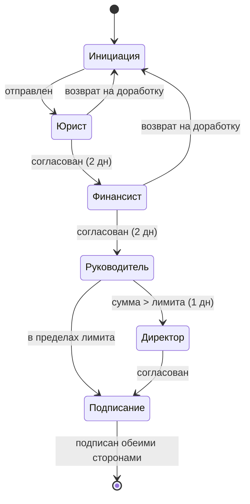

# Модель Документооборота и процессы холдинга (task_163)

ДО — система управления процессами, а не склад файлов: документ
проходит маршруты, задачи назначаются людям, сроки контролируются.

## Модель: сущности и связи

| Сущность | Что это | Ключевые свойства |
|---|---|---|
| Вид документа | договор, счёт, приказ со своим набором реквизитов | реквизиты вида, жизненный цикл |
| Документ | конкретный экземпляр вида с версиями | версии с основанием изменения: аудит спрашивает «что подписали тогда» |
| Процесс | маршрут: последовательный, параллельный, с условиями | этапы, условия ветвления настройками |
| Задача | единица работы человека | исполнитель (роль, не фамилия), срок, результат |
| Состояние документа | где документ по смыслу («утверждён») | ≠ состоянию процесса |
| Состояние процесса | где маршрут сейчас («ждёт подписи») | утверждено + ждём ≠ расхождение |

Исполнители — роли из оргструктуры, а не второй справочник людей,
который разъедется с кадровым. Процесс без владельца умирает
первым; проектирование маршрута — назад от конечного состояния
(«договор подписан обеими сторонами»), а не от документа.

## 5 процессов холдинга

| Процесс | Конечное состояние | Ценность | Владелец |
|---|---|---|---|
| Договор | подписан обеими сторонами | версия и согласователи не ищутся в почте | юрист |
| Счёт на оплату | оплачен или отклонён с причиной | счёт не «ждёт три дня неизвестно где» | финансист |
| Заявка на оплату | платёж в плане платежей | кассовые разрывы видны заранее | казначей |
| Приказ | доведён до исполнителей с подтверждением | «не видел приказ» невозможно | делопроизводитель |
| Акт выполненных работ | подписан, основание закрытия договора | закрывающие документы не теряются к отчётности | бухгалтер |

Не отдаём в ДО: оперативные складские документы RIH — у них своя
система и скорость (task_47); критерий — документ живёт согласованием
людей, а не проведением по регистрам.

## Маршрут договора (state machine)

Этапы и сроки: юрист 2 дн, финансист 2 дн, руководитель 1 дн;
просрочка этапа — эскалация владельцу процесса. Ветвление одно
(сумма > лимита → директор): каждое лишнее условие умножает
сценарии проверки, поэтому «на всякий случай» веток нет.
