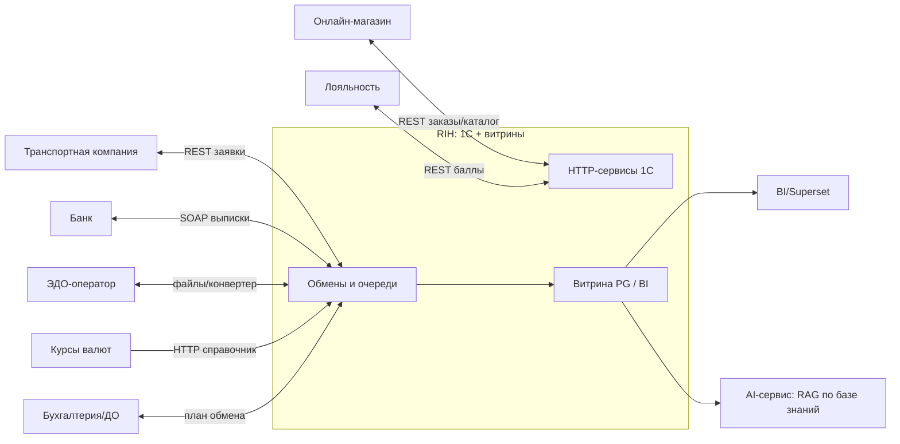

# Карта интеграций RIH (task_73)

## Схема потоков (C4, уровень контейнеров)

## Потоки: данные, способ, обоснование

| # | Пара | Данные | Направление | Частота/объём | Критичность/SLA | Способ и почему |
|---|---|---|---|---|---|---|
| 1 | Магазин ↔ RIH | Заказы | к нам | событийно, пики распродаж | высокая, приём ≤ 5 с | HTTP-сервис 1С: синхронное подтверждение и идемпотентность ключом |
| 2 | RIH → Магазин | Каталог и цены | от нас | раз в час, дельты | средняя | REST-клиент: партнёр сам тянет/мы пушим по контракту task_77 |
| 3 | RIH → Магазин | Остатки | от нас | раз в 15 мин | средняя: витрина терпит лаг | REST: полная картина не нужна, дельты дешевле |
| 4 | Магазин → RIH | Статусы заказов | оба | событийно | высокая | HTTP + PATCH статусов: владелец перехода фиксируется контрактом |
| 5 | Лояльность ↔ RIH | Баланс, начисление, списание | оба | синхронно при продаже | высокая: касса ждёт | REST синхронно + деградация (продажа без баллов по решению бизнеса, вопрос аналитику №5) |
| 6 | ТК ↔ RIH | Заявки, трекинг | оба | по расписанию | средняя | REST с уважением к 429/Retry-After (task_93) |
| 7 | Банк → RIH | Выписки, статусы платежей | к нам | ежедневно | высокая: финансы | SOAP (банк так умеет) + построчная сверка дублей |
| 8 | RIH → Банк | Платёжные поручения | от нас | по мере создания | высокая | SOAP, подтверждение статусом, не фактом отправки |
| 9 | Курсы валют → RIH | Справочник валют | к нам | раз в день | низкая | HTTP + кэш (ADR-0006 по духу: редко меняется) |
| 10 | ЭДО ↔ RIH | Юр. документы | оба | асинхронно | высокая: юр. значимость | Файлы/конвертер с аудитом приёма (task_115) |
| 11 | RIH → Витрина/BI | Факты продаж и остатков | от нас | CDC/пачками | средняя | Выгрузка в PG-витрину: отчёты не бьют OLTP (task_121) |
| 12 | Бухгалтерия/ДО ↔ RIH | НСИ, документы | оба | по расписанию | средняя | План обмена/КД: типовая топология для типовых баз |
| 13 | RIH → AI-сервис | База знаний, запросы RAG | оба | по запросу | низкая | HTTP внутри контура стенда |

## Три самые рискованные интеграции

1. **Заказы магазина (поток 1).** Дубли при ретраях бьют по складу
   (двойной резерв). Снижение: Idempotency-Key + 409 на конфликт,
   журнал приёма, контрактные тесты (task_105/140).
2. **Лояльность на кассе (поток 5).** Падение партнёра останавливает
   продажи, если идти синхронно в лоб. Снижение: таймаут, деградация
   «продажа без баллов» с компенсацией начислением позже (task_95/130).
3. **Банк (потоки 7–8).** Повторная выписка или потерянный статус —
   деньги и отчётность. Снижение: построчная сверка, идемпотентная
   загрузка, статусы только по ответу банка (task_118).
