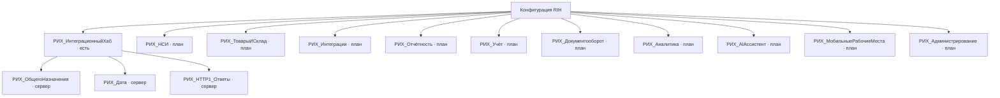

# Структура конфигурации RIH (task_7)

Дата: 2026-11-17 · Источник истины: `internship/Configuration/src/` (EDT).

## Что есть сейчас

Одна подсистема — `РИХ_ИнтеграционныйХаб` («Интеграционный хаб»). Она содержит
только три общих модуля; учётных объектов (справочников, документов,
регистров) в RIH пока нет — их создают задания следующих спринтов, и каждый
объект при создании относится к своей подсистеме, иначе он «теряется»
для пользователей и навигации.

### Общие модули стартовой конфигурации

| Модуль | Назначение | Контекст (флаги XML) | Кто использует |
|---|---|---|---|
| `РИХ_ОбщегоНазначения` | вспомогательные функции подсистемы (окружение, позже — коллекции, суммы, логирование, замеры) | server=true, serverCall=true, privileged=false; клиентских флагов нет | формы и внешние обработки (через вызов сервера), HTTP-сервис |
| `РИХ_Дата` | работа с датами: границы периодов, ISO 8601 (task_15, task_17) | server=true (и парные флаги по XML) | серверная логика интеграций и отчётов |
| `РИХ_HTTP1_Ответы` | ответы HTTP-сервиса RIH: единый формат ошибок и тел ответов | server=true (контур HTTP-сервисов) | HTTP-сервисы RIH (task_79, task_82) |

Вывод из флагов: методы этих модулей живут на сервере; с клиента их можно
вызывать только там, где стоит `serverCall`. Показать `Сообщить()` изнутри
серверного модуля нельзя — у сервера нет экрана: модуль возвращает строку,
показывает её клиентский код (см. `ПроверитьОкружение()` из task_2).

## Целевой состав подсистем (план из Configuration.xml)

| Подсистема | Что в ней будет | Где появляется |
|---|---|---|
| `РИХ_ИнтеграционныйХаб` | **есть**: общие модули стартера | task_0 |
| `РИХ_НСИ` | справочники, классификация, свойства | task_19+ |
| `РИХ_ТоварыИСклад` | документы и регистры склада | task_19+ |
| `РИХ_Интеграции` | HTTP-сервисы, обмены, очереди | task_73+ |
| `РИХ_Отчётность` | отчёты СКД, рассылки | sprint_5+ |
| `РИХ_Учёт` | трансляция проводок, ОСВ | task_151+ |
| `РИХ_Документооборот` | процессы и задачи | task_163+ |
| `РИХ_Аналитика` | витрины и BI | task_121+ |
| `РИХ_AIАссистент` | AI-сервис, RAG | task_231+ |
| `РИХ_МобильныеРабочиеМеста` | мобильное рабочее место | Q4 |
| `РИХ_Администрирование` | роли, журналы, обслуживание | task_9, task_290 |

## Запреты для модулей подсистемы РИХ_ИнтеграционныйХаб

1. **Никакой учётной (доменной) логики.** Модуль интеграций знает контракты
   внешних систем (форматы, статусы, ошибки), но не знает, как считается
   себестоимость или проводятся документы. Доменная логика — в модулях
   объектов и сервисных модулях своей подсистемы.
2. **Никакого клиентского в серверном.** Из серверного модуля нельзя
   `Сообщить()` и нельзя обращаться к формам: модуль возвращает данные,
   клиент их показывает.
3. **Никакого «Привилегированный» по умолчанию.** privileged=true только
   точечно и с обоснованием в комментарии: это та же ошибка, что
   «Полные права» всем, только в коде.
4. **Никаких обращений к данным в цикле и запросов, собранных
   конкатенацией строк** — один запрос на пакет данных, параметры —
   параметрами (подробно — разделы 3–4 CodingStandard.md).
