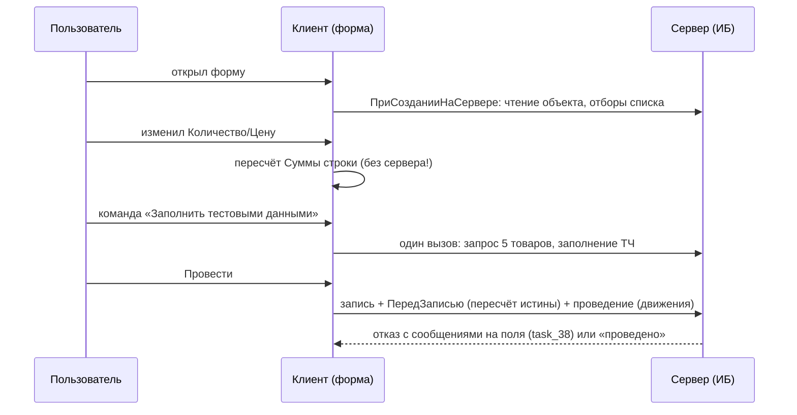

# task_37: схема «клиент ↔ сервер» формы документа «Поступление товаров»

## Что живёт где и почему

| Действие | Где | Почему |
|---|---|---|
| Пересчёт суммы строки при вводе | Клиент | Отзывчивость: серверный вызов на каждую цифру — лаги и нагрузка |
| Заполнение тестовыми данными | Сервер | Запрос к справочнику; на клиенте данных нет |
| Пересчёт суммы/базового количества при записи | Сервер (ПередЗаписью) | Истина: клиентским числам не верим (task_21) |
| Валидация и проведение | Сервер | Общие правила для формы, обменов и API (модуль РИХ_Валидация, task_38) |
| Сообщения об ошибках | Формирует сервер, показывает клиент | Привязка к полю: курсор переходит к ошибке |

## Реквизиты формы: нужны/лишние

Нужны на клиенте: Объект (документ), ТекущиеДанные ТЧ для пересчёта,
ОтборГруппа в списках. Лишние (вынесены/не тянем): полные данные
справочников в реквизиты формы (только ссылки — свойства читаются
через точку на сервере), кэши цен на клиенте (цена — запрос/СрезПоследних
на сервере, иначе клиент покажет вчерашнюю цену как истину).
